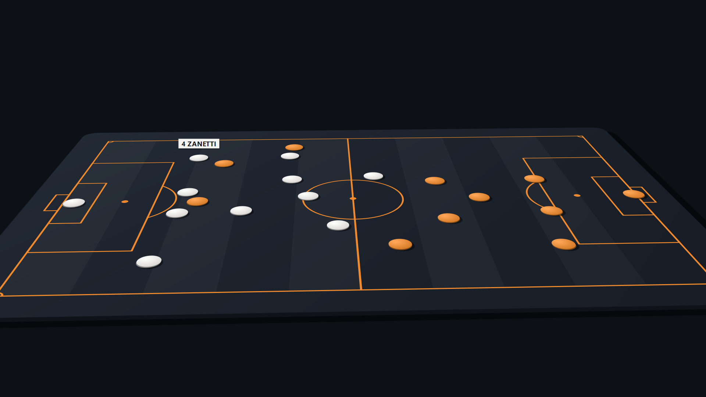

# Jorgardos-Tactics-Board
An open-source 2D/3D football tactics board with an animation studio, advanced tactical zones and many more features.

## What is this project? 
The look and feel of this board are inspired by the legendary tactical analysis videos from Coaches' Voice where top managers like José Mourinho explain their tactics. 

Here is an example rendered in the Programm: 

